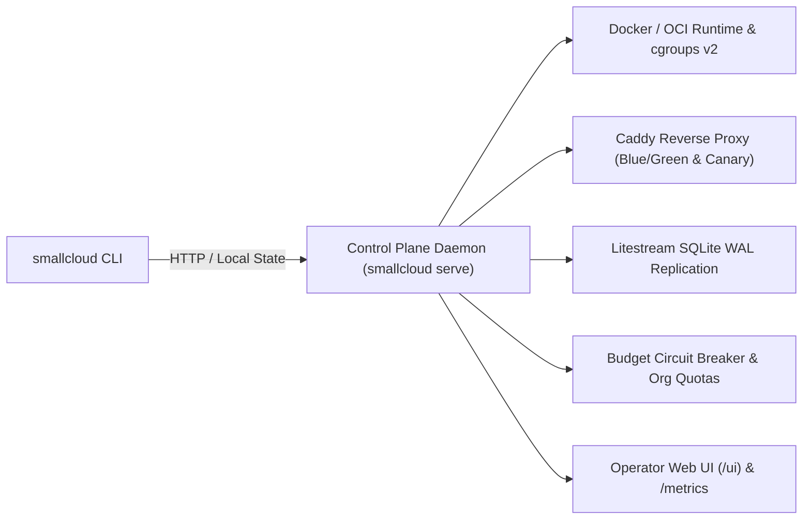

# SmallCloud

[](https://github.com/creova-gif/smallcloud/actions/workflows/ci.yml)
[](https://go.dev/)
[](LICENSE)

SmallCloud deploys single-node and edge-routed web applications from a repository to HTTPS in under 30 seconds. It enforces Linux cgroups v2 limits, replicates SQLite with Litestream, swaps Blue/Green and canary routes through Caddy, and stops traffic when an application reaches `max_monthly_usd`.

## Architecture



## Key Features

- **Zero-Downtime Blue/Green & Canary Swaps**: Atomic Caddy upstream switching, weighted canary traffic splitting (`X%` Blue / `Y%` Green), automated canary rollback, and instant `rollback` to previous releases.
- **Hard Monthly Budget Caps & Org Quotas**: Synchronous spend circuit breaker (`ErrBudgetExceeded` / HTTP `402` with `Retry-After`), per-app `max_monthly_usd` limits, automated monthly billing-cycle rollovers, and org-level aggregate quotas.
- **Streaming SQLite WAL Replication & Snapshot Pruning**: Bounded-buffer `io.Copy` + `io.TeeReader` WAL streaming with SHA-256 verification, atomic `os.Rename` restores, and automated retention-based snapshot pruning.
- **Durable Control-Plane State**: Atomic `state.json` persistence with `.bak` fallback recovery and `.sha256` checksum verification across daemon restarts.
- **Multi-Runtime Starter Templates**: Production-ready templates for FastAPI (`templates/fastapi-sqlite/`), Node.js 22 ESM (`templates/node-sqlite/`), and Go (`templates/go-sqlite/`).
- **Operator Web UI & Prometheus `/metrics`**: Embedded single-binary dashboard at `/` and `/ui` for inspecting app health, budget burn, and recent deployments, plus Prometheus metrics and `/healthz`.
- **HMAC Webhooks & GitOps**: HMAC-SHA256 signed budget/alert webhook deliveries (`X-SmallCloud-Signature-256`) and GitHub push webhook verification for GitOps deployments.

## Installation

Prebuilt release binaries for `linux` and `darwin` (`amd64` and `arm64`) with SHA-256 `checksums.txt` are published on GitHub Releases for `v*` tags.

Install with Go 1.23+:

```bash
go install github.com/creova-gif/smallcloud/cli/cmd/smallcloud@latest
```

Or build from source:

```bash
git clone https://github.com/creova-gif/smallcloud.git
cd smallcloud
go build -o smallcloud ./cli/cmd/smallcloud
```

## Quickstart

1. Scaffold a new application (`fastapi`, `node`, or `go`):

```bash
smallcloud init --template fastapi ./my-app
```

2. Run preflight checks:

```bash
smallcloud doctor --live ./my-app
```

3. Start the control-plane daemon (optional, for HTTP mode and the Operator Web UI):

```bash
smallcloud serve --addr 127.0.0.1:7420
```

4. Deploy and verify status:

```bash
smallcloud deploy ./my-app v1.0.0
smallcloud status ./my-app
```

## CLI Command Reference

| Command | Description | Example |
| :--- | :--- | :--- |
| `init` | Scaffold a `smallcloud.toml` starter (`fastapi`, `node`, or `go`) | `smallcloud init --template fastapi ./my-app` |
| `doctor` | Run local or live (`--live`) preflight checks | `smallcloud doctor --live ./templates/fastapi-sqlite` |
| `package` | Build bundle manifest (`Dockerfile`, `Caddyfile`, `litestream.yml`) | `smallcloud package ./templates/fastapi-sqlite` |
| `deploy` | Deploy an application release with cgroups, storage, and Blue/Green swap | `smallcloud deploy ./templates/fastapi-sqlite v1.0.0` |
| `rollback` | Roll back an application to its previous active release | `smallcloud rollback ./templates/fastapi-sqlite` |
| `canary` | Shift a percentage of traffic to the canary upstream | `smallcloud canary ./templates/fastapi-sqlite 20` |
| `canary-reconcile` | Evaluate canary health and promote or roll back automatically | `smallcloud canary-reconcile ./templates/fastapi-sqlite` |
| `status` | Inspect current release, route color, cgroups, and budget state | `smallcloud status ./templates/fastapi-sqlite` |
| `list` / `ps` | List all deployed applications managed by the control plane | `smallcloud list` |
| `logs` | Stream or fetch container logs for an application | `smallcloud logs ./templates/fastapi-sqlite` |
| `events` | Query the append-only control-plane audit event stream | `smallcloud events` |
| `budget` | View or update an application's `max_monthly_usd` cap | `smallcloud budget set ./templates/fastapi-sqlite 10.00` |
| `org-quota` | Set or inspect organization-level aggregate monthly spend quotas | `smallcloud org-quota set acme 100.00` |
| `meter` | Record metered spend against an application's monthly budget | `smallcloud meter ./templates/fastapi-sqlite 1.25` |
| `rollover` | Trigger monthly billing-cycle budget rollover | `smallcloud rollover` |
| `prune` | Prune historical local WAL snapshots keeping the latest N | `smallcloud prune ./templates/fastapi-sqlite 5` |
| `verify-snapshot` | Verify the integrity and SHA-256 checksum of the latest local WAL snapshot | `smallcloud verify-snapshot ./templates/fastapi-sqlite` |
| `backup` | Export an application's state and SQLite replica into a `.tar.gz` backup bundle | `smallcloud backup ./templates/fastapi-sqlite ./backup.tar.gz` |
| `restore-bundle` | Restore an application's state and SQLite replica from a `.tar.gz` backup bundle | `smallcloud restore-bundle ./backup.tar.gz` |
| `destroy` | Tear down an application, remove Caddy routes, and stop containers | `smallcloud destroy ./templates/fastapi-sqlite` |
| `nodes` | Manage multi-node worker pool registration and edge routing status | `smallcloud nodes` |
| `serve` | Start the HTTP control-plane daemon, API, `/metrics`, and Web UI | `smallcloud serve --addr 127.0.0.1:7420` |
| `eval` | Run the deterministic control-plane evaluation suite | `smallcloud eval` |
| `version` | Print the `smallcloud` CLI version | `smallcloud version` |

## Configuration (`smallcloud.toml`)

```toml
[app]
name = "fastapi-starter"
org_id = "org-indie-default"
domain = "starter.smallcloud.dev"
port = 8000
healthcheck = "/healthz"
runtime = "dockerfile"

[resources]
cpu_millicores = 500
memory_mb = 256

[budget]
max_monthly_usd = 5.00
alert_at_pct = 80.0
hard_stop = true

[storage]
sqlite_path = "/data/app.db"
replica_url = "gs://smallcloud-replicas/org-indie-default/fastapi-starter"
sync_ms = 1000

[env]
LOG_LEVEL = "info"
```

### Sections

- **`[app]`**: `name`, `org_id`, `domain`, `port` (default `8000`), `healthcheck` (default `/healthz`), `runtime` (default `dockerfile`).
- **`[resources]`**: `cpu_millicores` (default `500`), `memory_mb` (default `256`).
- **`[budget]`**: `max_monthly_usd`, `alert_at_pct` (default `80.0`), `hard_stop` (default `true`).
- **`[storage]`**: `sqlite_path` (default `/data/app.db`), `replica_url`, `sync_ms` (default `1000`).
- **`[env]`**: Key-value pairs injected securely into the container runtime.

## Environment Variables

| Variable | Description |
| :--- | :--- |
| `SMALLCLOUD_DAEMON_URL` | Base URL of a running `smallcloud serve` daemon (e.g., `http://127.0.0.1:7420`) so CLI commands talk to the daemon over HTTP instead of local state files. |
| `SMALLCLOUD_API_TOKEN` | Require `Authorization: Bearer <token>` on `/v1/*` HTTP endpoints (`/healthz` stays open) and attach the token from the CLI when `SMALLCLOUD_DAEMON_URL` is set. |
| `SMALLCLOUD_CADDY_ADMIN_URL` | Caddy Admin API URL used when syncing live Blue/Green routes. |
| `SMALLCLOUD_RUNTIME` | Container/process runtime backend selection for `smallcloud` deployments (e.g., `dockerfile`). |
| `SMALLCLOUD_WEBHOOK_URL` | Target HTTP endpoint for signed budget/alert webhook deliveries. |
| `SMALLCLOUD_WEBHOOK_SECRET` | HMAC-SHA256 signing secret for `X-SmallCloud-Signature-256` webhook headers. |
| `SMALLCLOUD_HEALTH_PROBE_TIMEOUT` | Timeout duration for HTTP readiness probes (e.g., `2s`). |
| `SMALLCLOUD_ROLLOVER_INTERVAL` | Background interval for automated monthly billing-cycle rollover checks (e.g., `1h`). |
| `SMALLCLOUD_RATE_LIMIT` | Maximum HTTP API requests per second allowed by `RateLimitMiddleware` (e.g., `20`). |
| `SMALLCLOUD_ACCESS_LOG` | Log structured JSON HTTP access records to stderr (default `true`). |
| `SMALLCLOUD_WORKER_TTL` | Stale worker-node reaper TTL in `smallcloud serve` (default `5m`). |

## Benchmark Results

Generate the release binary and run 7 iterations of `smallcloud eval`:

```bash
go build -o /tmp/smallcloud-bin ./cli/cmd/smallcloud
for i in 1 2 3 4 5 6 7; do /tmp/smallcloud-bin eval; done
```

| Metric | Target | Measured (7 runs, release binary) | Limiter |
| :--- | :--- | :--- | :--- |
| Deploy control-plane swap | `< 30,000 ms` | `0 ms` median (`0` to `2 ms` range) | Local filesystem `cpu.max` and `memory.max` writes |
| Route swap and rollback | `< 300 ms` | `0 ms` median (`0` to `8 ms` range) | Mutex acquisition and map update in `CaddyRouter` |
| Spend cap stop (`max_monthly_usd`) | `100%` | `100%` (`100/100` calls rejected with `ErrBudgetExceeded`) | Synchronous check in `BudgetTracker.CheckAllowed` |
| SQLite restart data loss | `0 bytes` | `0 bytes` (`55/55` bytes and SHA-256 verified) | Temp-file write and atomic `os.Rename` |

## Repository Layout

- `cli/`: CLI commands, HTTP `DaemonClient`, `doctor` preflight checks, and entrypoint `cli/cmd/smallcloud/main.go`.
- `daemon/`: Control-plane HTTP server, cgroups v2 writer, `StorageManager`, `CaddyRouter`, `BudgetTracker`, audit log, webhooks, GitOps, canary auto-rollback, and Operator Web UI.
- `pkg/config/`: `smallcloud.toml` parser and validator (`org_id` tenant scoping, `max_monthly_usd`, `[env]`).
- `pkg/core/`: Release artifact attestation and HTTP readiness health probing.
- `templates/fastapi-sqlite/`: Python 3.12 FastAPI + SQLite starter (`Dockerfile`, `Caddyfile`, `litestream.yml`, `smallcloud.toml`).
- `templates/node-sqlite/`: Zero-dependency Node.js 22 ESM HTTP starter (`Dockerfile`, `smallcloud.toml`, `server.mjs`, `test_server.mjs`).
- `templates/go-sqlite/`: Zero-dependency Go starter (`Dockerfile`, `smallcloud.toml`, `main.go`, `main_test.go`).
- `docs/`: Architecture Decision Records, Threat Model, and design documents.

## Documentation

- [ADR-001: SmallCloud Architecture Decision Record](docs/adr/001-small-software-architecture.md)
- [Threat Model](docs/THREAT_MODEL.md)
- [Contributing Guide](CONTRIBUTING.md)
- [Changelog](CHANGELOG.md)

## License

Licensed under the [MIT License](LICENSE).
